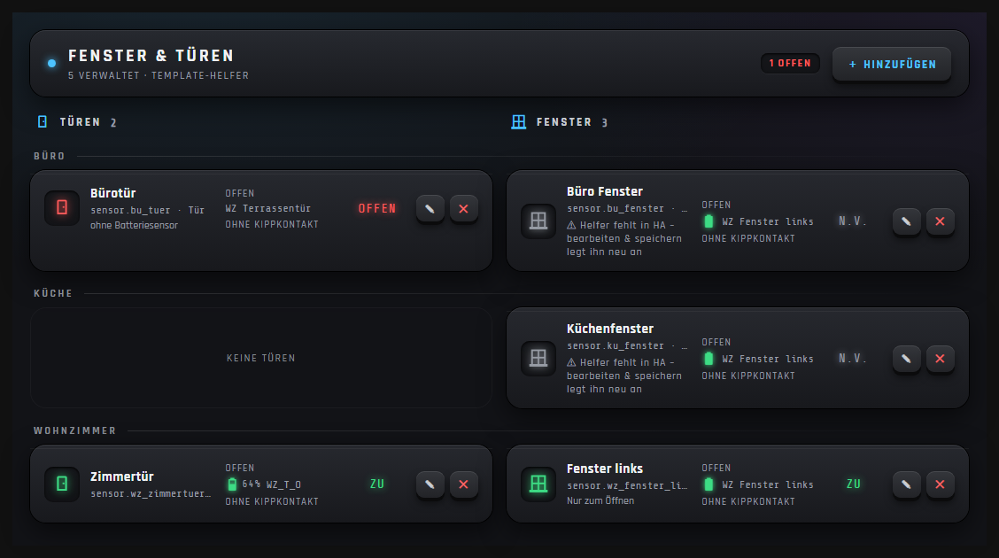

# Door & Window Manager Card



*Rendered from the card code with example data (no real Home Assistant).*

Lovelace card (`custom:fenster-tuer-manager`) that creates and manages windows and doors as **template helpers** from one or two contact sensors. For every window/door it creates two UI template helpers:

- `sensor.<id>` – state `open` / `tilted` / `closed` (used e.g. by the floor plan of the Room Tablet cards)
- `binary_sensor.<id>` – device class window/door, `on` = open or tilted (for HA, voice assistants, automations)

UI language: German.

## Features

- Add / edit / delete windows and doors in a form: name, entity id, type (window/door), icon, area, description
- Contact for "open" and optional second contact for "tilted" (tilt-and-turn windows)
- Optional battery sensors (low / percent) per contact
- Overview grouped by area, live state preview
- Deleting removes both helpers; the contact sensors themselves are left untouched

## Requirements

- Home Assistant template integration (built in)
- The Jinja macro file [`custom_templates/fenster_tuer.jinja`](custom_templates/fenster_tuer.jinja) from this repo copied to `/config/custom_templates/fenster_tuer.jinja` (then reload custom templates via Developer tools → YAML or restart). The helpers' templates import `kontakt` and `verfuegbar` from it.
- The dashboard holding the card must be a **UI-managed (storage mode) dashboard**: the card saves its list of entries into its own card configuration via `lovelace/config/save`. YAML dashboards cannot be written.
- Admin user (creates config entries and changes the entity registry).

## Installation

### HACS (custom repository)

1. HACS → ⋮ → **Custom repositories** → add `https://github.com/SysriX/door_window_manager_ha_card`, category **Dashboard**.
2. Install the card from HACS and reload the browser.
3. HACS registers the resource automatically: `/hacsfiles/door_window_manager_ha_card/door_window_manager_ha_card.js` (JavaScript module).

### Manual

1. Copy `dist/door_window_manager_ha_card.js` to `/config/www/door_window_manager_ha_card.js`.
2. Settings → Dashboards → ⋮ → **Resources** → add `/local/door_window_manager_ha_card.js` as **JavaScript module**.
3. Reload the browser.

## Configuration

```yaml
type: custom:fenster-tuer-manager
dashboard: windows-doors   # optional: url_path of the dashboard holding this card
                           # (default: the dashboard currently open)
items: []                  # managed by the card itself – do not edit by hand
```

The card loads the fonts Rajdhani and Share Tech Mono from Google Fonts.

## Notes

This card was built for the author's own home and tablets. Some defaults (entity ids, dashboard paths) reflect that setup and may need to be set explicitly in your configuration.

## Version

1.3.1

## License

MIT – see [LICENSE](LICENSE).
